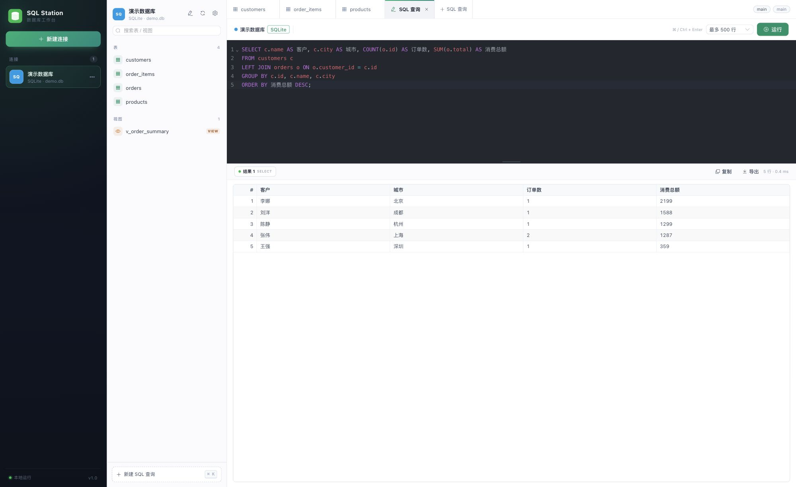

# SQL Station · 多数据库 SQL 管理工作台

基于 **Python FastAPI + Vue 3** 的前后端分离 SQL 数据库管理系统。支持 **SQLite / MySQL / PostgreSQL / SQL Server / Oracle**，可在一个界面中管理连接、浏览数据、查看表结构、执行 SQL 并导出结果。

  

## 功能特性

- **多数据库连接**：SQLite、MySQL、PostgreSQL、SQL Server、Oracle，连接配置集中管理。
- **连接管理**：新增、编辑、删除、连接测试、只读模式；密码使用 Fernet 加密保存。
- **对象浏览**：数据库 / Schema 切换、表与视图列表、字段、主键、索引、外键、DDL。
- **数据浏览**：分页、每页行数调整、列排序、自定义 `WHERE` 条件筛选、CSV 导出。
- **行级操作**：图形化新增 / 编辑 / 删除数据（基于主键，支持复合主键）。
- **SQL 执行窗口**：CodeMirror 6 语法高亮、表字段自动补全、`⌘ / Ctrl + Enter` 执行、多语句执行、结果集切换、复制与导出。
- **安全保护**：只读连接会在 API 与数据库会话两层阻止写操作；错误信息自动脱敏。
- **前后端分离**：开发时 Vite 代理后端 API；生产构建后也可由 FastAPI 直接托管前端静态文件。

## 界面预览



## 技术栈

| 层 | 技术 |
| --- | --- |
| 后端 | FastAPI、SQLAlchemy 2.0、Uvicorn、Pydantic v2 |
| 数据库驱动 | SQLite（内置）、PyMySQL、pg8000、pymssql（可选）、oracledb（可选） |
| 前端 | Vue 3、Vite、Element Plus、Axios、CodeMirror 6 |
| 元数据存储 | 本地 SQLite（`backend/data/admin.db`） |
| 部署 | Docker 多阶段构建、docker compose |

## 项目结构

```
sql_admin/
├── backend/
│   ├── app/
│   │   ├── main.py             # FastAPI 入口、CORS、静态托管
│   │   ├── config.py           # 数据目录、行数上限等配置
│   │   ├── db.py               # 本地元数据库
│   │   ├── models.py           # 连接配置模型
│   │   ├── schemas.py          # Pydantic 模型
│   │   ├── deps.py             # 连接加载 / 只读校验
│   │   ├── routers/
│   │   │   ├── connections.py  # 连接 CRUD 与测试
│   │   │   ├── explorer.py     # 目录、表、行、导出、概览
│   │   │   └── query.py        # SQL 执行
│   │   └── services/
│   │       ├── connections.py  # 连接串、引擎缓存、测试
│   │       ├── introspect.py   # 跨库元数据与数据操作
│   │       ├── executor.py     # SQL 拆分、只读保护、执行
│   │       └── serialize.py    # 数据库值 JSON 序列化
│   ├── scripts/seed_demo.py    # 生成演示 SQLite 数据库
│   ├── tests/test_api.py       # SQLite 全流程 API 测试
│   └── requirements.txt
├── frontend/
│   ├── src/
│   │   ├── App.vue
│   │   ├── api.js
│   │   ├── utils.js
│   │   ├── styles.css
│   │   └── components/
│   │       ├── ConnectionDialog.vue
│   │       ├── TableSidebar.vue
│   │       ├── DashboardPane.vue
│   │       ├── TablePane.vue
│   │       ├── DataGrid.vue
│   │       ├── StructurePane.vue
│   │       ├── RowDialog.vue
│   │       ├── QueryPane.vue
│   │       └── SqlEditor.vue
│   └── package.json
├── Dockerfile                  # 前端构建 + Python 运行多阶段镜像
├── docker-compose.yml          # 一键启动与数据卷
├── docker-build.sh             # Docker 镜像构建脚本
├── .dockerignore
├── start.sh
└── docs/                       # 界面截图
```

## 快速开始

### 环境要求

- Python 3.9+
- Node.js 18+（推荐 20+）
- npm 9+
- Docker 20.10+ / Compose v2（可选，用于镜像部署）

### 一键启动（开发模式）

```bash
chmod +x start.sh
./start.sh
```

脚本会自动创建虚拟环境、安装依赖，并同时启动：

- 后端 API：<http://127.0.0.1:8000> （接口文档 <http://127.0.0.1:8000/docs>）
- 前端界面：<http://127.0.0.1:5173>

### 手动启动

```bash
# 1. 后端
python3 -m venv .venv
source .venv/bin/activate
pip install -r backend/requirements.txt
cd backend
uvicorn app.main:app --host 127.0.0.1 --port 8000 --reload

# 2. 前端（另开终端）
cd frontend
npm install
npm run dev
```

### 生成演示数据

```bash
source .venv/bin/activate
python backend/scripts/seed_demo.py
```

然后在界面中新建连接：

- 类型：`SQLite`
- 路径：`demo.db`（相对路径会解析到 `backend/data/demo.db`）

## Docker 部署

镜像采用多阶段构建：Node 阶段编译 Vue 前端，Python 阶段安装后端依赖并由 FastAPI 托管构建后的静态页面。最终镜像以非 root 用户 `app` 运行，暴露 `8000` 端口。

### 方式一：使用构建脚本

```bash
chmod +x docker-build.sh
./docker-build.sh
```

脚本默认构建 `sql-station:latest`，构建完成后按提示运行：

```bash
docker run -d --name sql-station \
  -p 8000:8000 \
  -v sql-station-data:/app/data \
  --restart unless-stopped \
  sql-station:latest
```

访问 <http://127.0.0.1:8000>。

常用参数：

```bash
# 指定镜像名与标签
./docker-build.sh --tag sql-station:1.0.0

# 一并安装 SQL Server / Oracle 可选驱动
./docker-build.sh --with-mssql --with-oracle

# 不使用缓存重新构建
./docker-build.sh --no-cache

# 多架构构建并推送到镜像仓库（需要 buildx 与 docker login）
./docker-build.sh \
  --platform linux/amd64,linux/arm64 \
  --tag registry.example.com/sql-station:latest \
  --push

# 查看完整帮助
./docker-build.sh --help
```

### 方式二：docker compose

```bash
docker compose up -d --build
docker compose logs -f sql-station
docker compose down
```

可通过环境变量修改端口，或在 `.env` 中设置：

```bash
SQL_STATION_PORT=8080 docker compose up -d
```

如需 SQL Server / Oracle 驱动，构建时传入：

```bash
INSTALL_MSSQL=true INSTALL_ORACLE=true docker compose build
```

### 数据持久化

镜像内数据目录为 `/app/data`，其中保存：

- `admin.db`：连接配置与加密后的密码
- `secret.key`：Fernet 加密密钥，请妥善保管
- `*.db`：使用相对路径创建的 SQLite 数据库文件

`docker-compose.yml` 使用命名卷 `sql-station-data` 持久化数据。删除容器不会丢失数据；执行 `docker compose down -v` 才会删除数据卷。

在容器中新建 SQLite 连接时，建议填写相对路径（例如 `demo.db`），文件会保存在 `/app/data` 数据卷内。不要填写宿主机的绝对路径，除非同时把对应目录挂载进容器。

也可以绑定宿主机目录：

```bash
docker run -d --name sql-station \
  -p 8000:8000 \
  -v "$PWD/backend/data:/app/data" \
  sql-station:latest
```

> 容器以 UID/GID 非 root 用户运行。使用宿主机目录挂载时，请确保该目录对容器内 `app` 用户可写。

### 在容器内生成演示数据

```bash
docker compose exec sql-station python scripts/seed_demo.py --force
```

然后在界面中新建 SQLite 连接，路径填写 `demo.db` 即可（相对路径会解析到 `/app/data/demo.db`）。

## 生产部署

```bash
cd frontend && npm run build
cd ../backend
uvicorn app.main:app --host 127.0.0.1 --port 8000
```

前端构建产物位于 `frontend/dist`。启动后端时如果该目录存在，FastAPI 会自动托管静态页面，直接访问 <http://127.0.0.1:8000> 即可。API 仍保留在 `/api` 前缀下，前后端代码保持独立。

> 项目默认不内置用户认证。请仅绑定 `127.0.0.1` 本地使用；如需暴露到公网，请在反向代理层增加 HTTPS 与身份认证。

## 配置项

可以将 `backend/.env.example` 复制为 `backend/.env` 后修改（启动时会自动加载）：

```bash
cp backend/.env.example backend/.env
```

通过环境变量配置：

| 变量 | 默认值 | 说明 |
| --- | --- | --- |
| `SQL_ADMIN_DATA_DIR` | `backend/data` | 元数据库、密钥、默认 SQLite 文件目录 |
| `SQL_ADMIN_MAX_ROWS_LIMIT` | `5000` | 单次 SQL 返回行数上限 |
| `SQL_ADMIN_MAX_PAGE_SIZE` | `500` | 数据浏览单页上限 |
| `SQL_ADMIN_CORS_ORIGINS` | `http://localhost:5173,http://127.0.0.1:5173` | 允许的前端来源，逗号分隔 |
| `SQL_ADMIN_FRONTEND_DIST` | `frontend/dist` | 生产前端静态目录 |

## 可选数据库驱动

SQLite / MySQL / PostgreSQL 的驱动已包含在 `requirements.txt`。SQL Server 与 Oracle 按需安装：

```bash
pip install pymssql   # SQL Server
pip install oracledb  # Oracle（thin 模式，无需 Instant Client）
```

## API 概览

| 方法 | 路径 | 说明 |
| --- | --- | --- |
| GET | `/api/health` | 健康检查 |
| GET/POST | `/api/connections` | 连接列表 / 新建连接 |
| PUT/DELETE | `/api/connections/{id}` | 更新 / 删除连接 |
| POST | `/api/connections/test` | 测试连接配置 |
| GET | `/api/connections/{id}/catalogs` | 数据库与 Schema 列表 |
| GET | `/api/connections/{id}/tables` | 表 / 视图列表 |
| GET | `/api/connections/{id}/tables/{table}` | 表结构、索引、外键、DDL |
| GET | `/api/connections/{id}/tables/{table}/rows` | 分页数据（排序 / WHERE） |
| POST/PUT/DELETE | `/api/connections/{id}/tables/{table}/rows` | 行级增删改 |
| GET | `/api/connections/{id}/tables/{table}/export` | 导出 CSV |
| GET | `/api/connections/{id}/completion` | SQL 编辑器补全信息 |
| GET | `/api/connections/{id}/overview` | 版本、大小、表数量等概览 |
| POST | `/api/connections/{id}/query` | 执行 SQL（支持多语句） |

完整交互式文档见 `/docs`。

## 测试

```bash
source .venv/bin/activate
cd backend
pytest
```

测试使用临时 SQLite 数据库，覆盖连接管理、对象浏览、分页筛选、行级 CRUD、只读保护、多语句查询与 CSV 导出。

## 安全说明

- 连接密码使用 `cryptography.Fernet` 加密后存入本地 SQLite；密钥保存在 `backend/data/secret.key`，请勿提交或泄露。
- 只读模式会在执行前拦截写语句，并对 SQLite / PostgreSQL / MySQL 额外开启数据库会话级只读。
- `WHERE` 条件与 SQL 编辑器属于受信任的管理能力，仅建议在受控环境使用。
- 修改连接或删除连接会释放对应的数据库连接池。

## License

MIT
